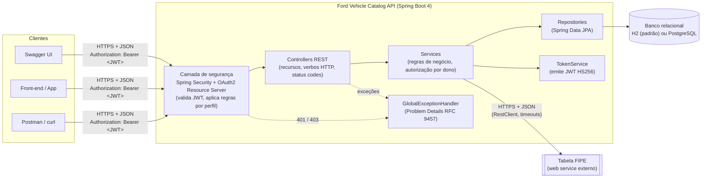
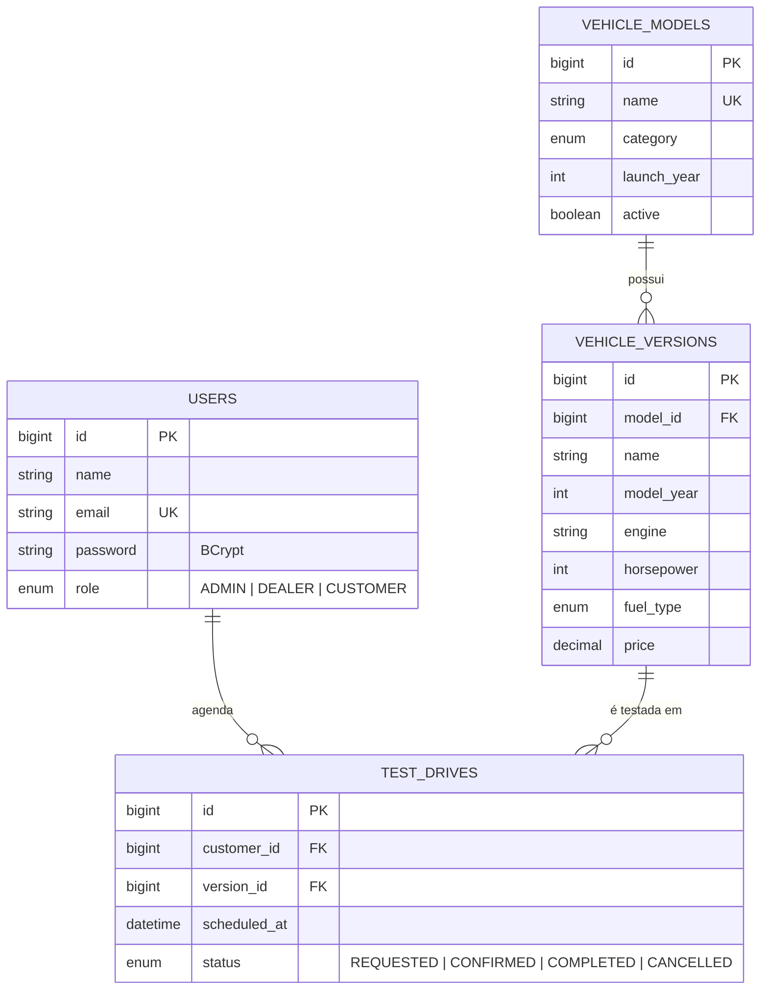
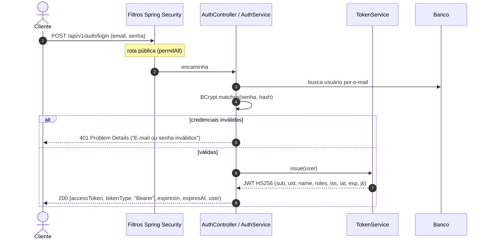
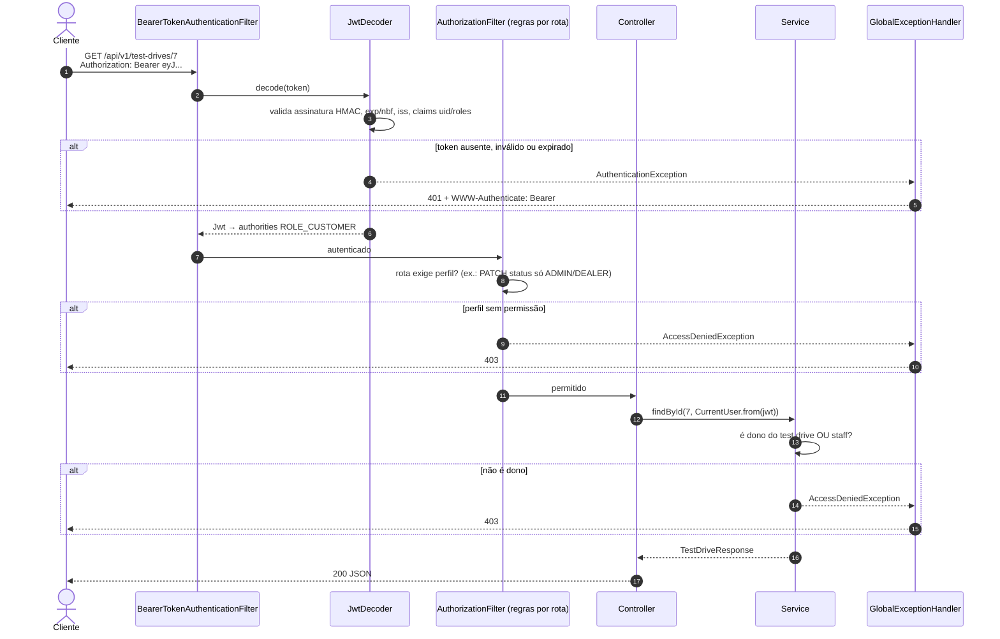

# Arquitetura da solução — Ford Vehicle Catalog API

## 1. Visão geral

A solução é um **web service REST** (nível 2 de maturidade de Richardson) que expõe o catálogo de veículos Ford
(modelos e versões) e o agendamento de test drives. Ela é **stateless**: não existe sessão no servidor e cada
requisição protegida carrega um **JWT** que prova quem é o usuário e qual o seu perfil.

## 2. Componentes e responsabilidades

| Camada / pacote | Classes principais | Responsabilidade |
|---|---|---|
| `controller` | `AuthController`, `VehicleModelController`, `VehicleVersionController`, `TestDriveController`, `UserController`, `FipeController` | Mapear **recursos** em URIs, receber/validar DTOs (`@Valid`), escolher o **verbo** e o **status code** (201 + `Location`, 204...). Não contém regra de negócio. |
| `service` | `AuthService`, `VehicleModelService`, `VehicleVersionService`, `TestDriveService`, `UserService`, `FipeService` | Regras de negócio e transações: unicidade (409), regras de estado (422), **autorização por propriedade** (cliente só acessa o próprio test drive). |
| `repository` | `*Repository` (Spring Data JPA) | Acesso a dados. |
| `domain` | `VehicleModel`, `VehicleVersion`, `TestDrive`, `User`, enums | Entidades JPA e invariantes (ex.: transições válidas de `TestDriveStatus`). |
| `dto` | `*Request`, `*Response` (records) | Contrato da API, desacoplado das entidades. Senha **nunca** sai em respostas. |
| `security` | `SecurityConfig`, `JwtConfig`, `TokenService`, `CurrentUser`, `RestAuthenticationEntryPoint`, `RestAccessDeniedHandler` | Autenticação (JWT), autorização por perfil/rota, geração e validação de tokens. |
| `integration.fipe` | `FipeClient`, `FipeConfig`, `FipeProperties` | Consumo do web service externo da Tabela FIPE: chamadas HTTP com timeout e tradução das falhas externas em 404/502. |
| `exception` | `GlobalExceptionHandler`, `ResourceNotFoundException`, `ConflictException`, `BusinessRuleException`, `ExternalServiceException` | Tradução de exceções em respostas de erro **padronizadas**. |
| `config` | `OpenApiConfig`, `CorsConfig`, `DataInitializer` | Documentação OpenAPI/Swagger, política de CORS e carga inicial (usuários de exemplo + catálogo). |

### Modelo de dados

## 3. Fluxo de autenticação

## 4. Fluxo de uma requisição protegida

## 5. Autorização em duas camadas

1. **Por perfil e rota** (`SecurityConfig`): decide *quem pode chamar* cada combinação verbo + URI.
2. **Por propriedade do recurso** (`TestDriveService`): usa a claim `uid` do token para garantir que um
   `CUSTOMER` só enxergue/cancele os próprios agendamentos.

| Endpoint | Anônimo | CUSTOMER | DEALER | ADMIN |
|---|:-:|:-:|:-:|:-:|
| `POST /auth/login`, `POST /auth/register` | ✅ | ✅ | ✅ | ✅ |
| `GET /auth/me` | ❌ 401 | ✅ | ✅ | ✅ |
| `GET /models/**` (modelos e versões) | ✅ | ✅ | ✅ | ✅ |
| `POST`/`PUT /models/**` | ❌ 401 | ❌ 403 | ✅ | ✅ |
| `DELETE /models/**` | ❌ 401 | ❌ 403 | ❌ 403 | ✅ |
| `POST /test-drives` | ❌ 401 | ✅ | ❌ 403 | ❌ 403 |
| `GET /test-drives`, `GET /test-drives/{id}` | ❌ 401 | ✅ só os seus | ✅ todos | ✅ todos |
| `PATCH /test-drives/{id}/status` | ❌ 401 | ❌ 403 | ✅ | ✅ |
| `DELETE /test-drives/{id}` | ❌ 401 | ✅ os seus, se `REQUESTED` | ❌ 403 | ✅ |
| `/users/**` | ❌ 401 | ❌ 403 | ❌ 403 | ✅ |

## 6. Decisões de design

| Decisão | Motivo |
|---|---|
| **JWT HS256 via Spring Security OAuth2 Resource Server** (Nimbus) | Usa o suporte oficial do Spring para validar tokens, em vez de um filtro caseiro. A validação cobre assinatura, `exp`/`nbf` (com tolerância de 60s), emissor (`iss`) e presença das claims `uid`/`roles`. |
| **Claims mínimas** (`sub`, `uid`, `name`, `roles`, `iss`, `iat`, `exp`, `jti`) | O JWT é só assinado, não criptografado, então dados sensíveis ficam de fora. `uid` e `roles` evitam uma ida ao banco a cada requisição. |
| **Expiração curta e configurável** (`app.jwt.expiration`, padrão 1h) | Limita o estrago se um token vazar. Consequência de ser stateless: mudar o perfil de um usuário só vale no **próximo login** (há teste cobrindo isso). |
| **Segredo por variável de ambiente** (`JWT_SECRET`), com mínimo de 32 bytes | Segredo fora do código em produção; a aplicação nem sobe com uma chave fraca. |
| **Cadastro público sempre como CUSTOMER** | Impede escalonamento de privilégio pelo `/register`. Só um ADMIN promove usuários. |
| **Mesma mensagem para e-mail inexistente e senha errada** | Não revela quais e-mails estão cadastrados. |
| **Versões como sub-recurso** (`/models/{id}/versions/{id}`) | A URI mostra a hierarquia; uma versão de outro modelo retorna 404. |
| **Problem Details (RFC 9457)** para todos os erros, inclusive 401/403 dos filtros | Os handlers de segurança delegam ao `GlobalExceptionHandler`, então o cliente trata um único formato de erro. |
| **H2 por padrão, PostgreSQL por profile** | Roda sem instalar nada; o profile `postgres` usa um banco real. |

## 7. Maturidade REST — nível 2

- **Recursos** identificados por substantivos no plural: `/models`, `/models/{id}/versions`, `/test-drives`, `/users`.
- **Verbos HTTP com a semântica correta:**
  - `GET` só lê (seguro e idempotente);
  - `POST` cria e responde **201 Created** com header `Location`;
  - `PUT` substitui o recurso inteiro (idempotente) e responde **200**;
  - `PATCH` faz alteração parcial (`/status`, `/role`) e responde **200**;
  - `DELETE` remove e responde **204 No Content**.
- **Status codes coerentes:**

| Código | Quando |
|---|---|
| 200 OK | Leitura, atualização, login |
| 201 Created | Criação (`Location` aponta para o novo recurso) |
| 204 No Content | Remoção |
| 400 Bad Request | Validação (`errors[]` por campo), JSON malformado, tipo/enum inválido |
| 401 Unauthorized | Sem token, token inválido/expirado/adulterado, credenciais erradas |
| 403 Forbidden | Perfil sem permissão ou recurso de outro usuário |
| 404 Not Found | Recurso ou rota inexistente |
| 405 Method Not Allowed | Verbo não suportado no recurso |
| 409 Conflict | Duplicidade (nome de modelo, e-mail) ou remoção com dependentes |
| 415 Unsupported Media Type | `Content-Type` diferente de JSON |
| 422 Unprocessable Content | Regra de negócio (modelo fora de linha, transição de status inválida) |
| 500 Internal Server Error | Erro inesperado (sem vazar stack trace) |
